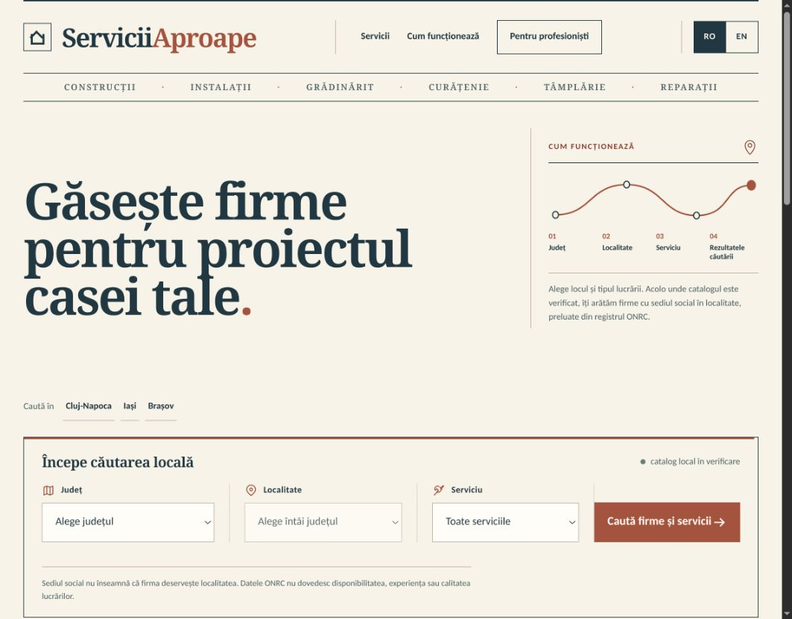

<div align="center">
  
  <h1>ServiciiAproape</h1>
  <p>Marketplace local pentru servicii dedicate casei, construit pentru piața din România.</p>

  <p>
    
    
    
    
  </p>
</div>



ServiciiAproape pune în legătură oamenii care au nevoie de lucrări pentru casă cu firme și profesioniști din zona lor. Căutarea pornește de la județ și localitate, nu de la o listă generală de firme, iar diferența dintre datele legale ONRC și informațiile declarate de furnizori rămâne vizibilă în produs.

## Ce funcționează în proiect

### 🔎 Căutare și descoperire

- căutare după județ, localitate SIRUTA și tip de serviciu;
- catalog pentru toate cele 42 de județe, cu 72.881 de identități de firme în snapshot-ul inclus;
- șapte opțiuni de servicii: construcții, instalații, electricieni, grădinărit, curățenie, tâmplărie și reparații;
- pagini de firmă bazate pe informații ONRC și pagini separate pentru furnizorii cu profil public;
- pagini locale bilingve, în română și engleză;
- listă de firme salvate în sesiunea browserului, fără obligația de a crea cont.

### 🧾 Cereri și oferte

- solicitare directă către un furnizor;
- o singură cerere trimisă către mai mulți furnizori eligibili din aceeași zonă;
- spațiu privat pentru conversație, oferte și comparația răspunsurilor;
- oferte cu linii de preț, cantitate și unitate, totalul fiind calculat pe server;
- acceptarea unei singure oferte și închiderea automată a ofertelor concurente;
- propuneri de vizită, confirmare sau refuz și anulare controlată.

### 👤 Contul clientului

- înregistrare, autentificare, schimbare și recuperare a parolei;
- panou cu solicitările directe și proiectele trimise către mai multe firme;
- filtrare pentru ofertele care așteaptă un răspuns;
- mesaje, oferte și starea lucrării într-un singur loc;
- recenzie după acceptarea unei oferte, cu moderare înainte de publicare.

### 🧰 Spațiul furnizorului

- revendicarea unei firme existente sau înscrierea uneia care nu apare în catalog;
- verificare administrativă cu document de reprezentare păstrat privat;
- profil public, servicii, localități acoperite, date de contact și portofoliu;
- inbox privat pentru solicitări, note și conversații cu clienții;
- oferte comerciale, programări, lucrări și agendă săptămânală;
- registru CRM privat pentru contacte și urmărirea solicitărilor;
- statistici agregate pentru vizualizări și acțiuni pe profil.

### 👷 Lucrări și echipă

- transformarea ofertei acceptate într-o lucrare care poate fi programată;
- invitații pentru tehnicieni și atribuirea lucrărilor;
- acces limitat: tehnicianul vede doar lucrările proprii;
- confirmarea începerii și finalizării lucrării;
- avertizare pentru intervale care se suprapun;
- draft privat de facturare și evidență manuală a încasărilor.

### 🛡️ Administrare și siguranță

- fluxuri separate de aprobare pentru revendicări, servicii, profiluri și recenzii;
- tokenuri păstrate sub formă de digest, protecție la replay și limitarea încercărilor;
- retenție și export pentru datele personale;
- audituri operaționale fără expunerea identității clienților;
- medii distincte pentru dezvoltare, preview și producție;
- interfață responsive, verificată pe desktop și mobil.

## Limite asumate

Proiectul nu prezintă datele ONRC drept recomandări sau garanții de calitate. Sediul social nu dovedește zona în care firma lucrează, iar serviciile și disponibilitatea dintr-un profil sunt declarații ale furnizorului.

Abonamentul demo nu procesează plăți. Draftul de facturare nu este factură fiscală, nu emite număr de document și nu trimite date către RO e-Factura. În mediul cloud de dezvoltare, mesajele e-mail sunt afișate în logurile containerului; configurarea SMTP reală aparține mediului de producție.

## Tehnologii

| Zonă | Implementare |
| --- | --- |
| Aplicație | Python, Django |
| Date operaționale | PostgreSQL 17 |
| Catalog de preview | SQLite validat prin checksum |
| Interfață | Django Templates, CSS, JavaScript progresiv |
| Rulare | Docker, Docker Compose, Gunicorn |
| Verificare | teste Django, teste JavaScript, Playwright, contracte Docker |

## Pornire locală

Varianta completă de dezvoltare pornește Django, PostgreSQL și volumele persistente:

```bash
cd CasaMea-copie
cp apps/casa_mea/deploy/managed-cloud.env.example .env
# Completează în .env datele administratorului inițial.
docker compose up --build -d
```

Aplicația este disponibilă implicit la `http://localhost:8000`, iar administrarea la `http://localhost:8000/admin/`.

Pentru oprire fără ștergerea datelor:

```bash
docker compose down
```

> `docker compose down --volumes` șterge baza de date și fișierele persistente. Folosește comanda doar pentru un mediu local dispensabil.

## Structura repository-ului

```text
.
├── apps/casa_mea/   # aplicația Django, teste, asset-uri și configurări Docker
├── ai/              # planul produsului, arhitectură și workflow
├── LEARNINGS.md     # decizii și lecții tehnice păstrate între etape
└── docker-compose.yml
```

Documentația pentru cloudul de dezvoltare se află în [`apps/casa_mea/deploy/README.md`](apps/casa_mea/deploy/README.md), iar detaliile de arhitectură în [`ai/ARCHITECTURE.md`](ai/ARCHITECTURE.md).
